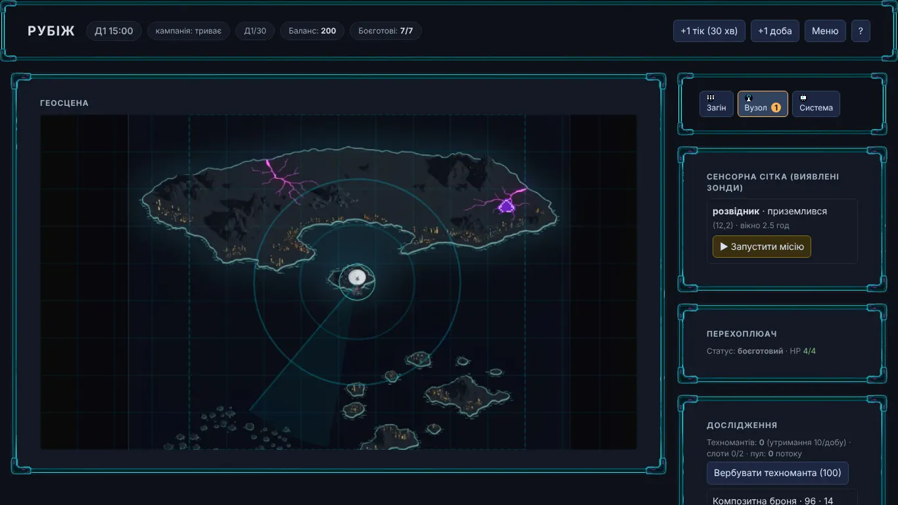
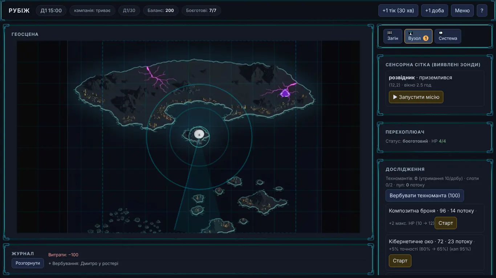
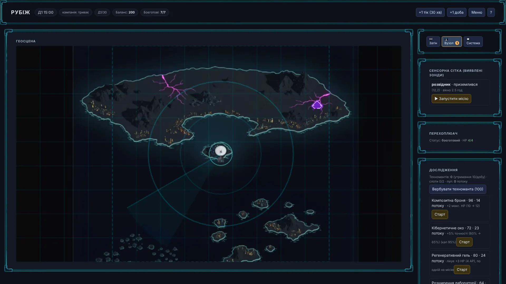
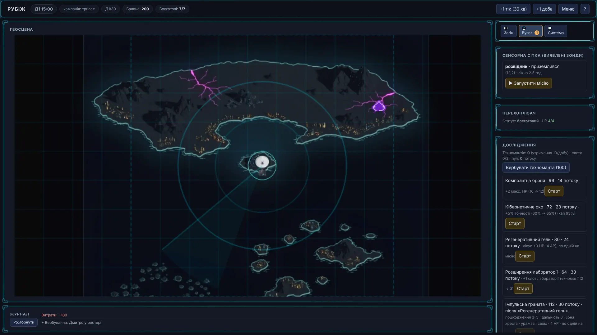
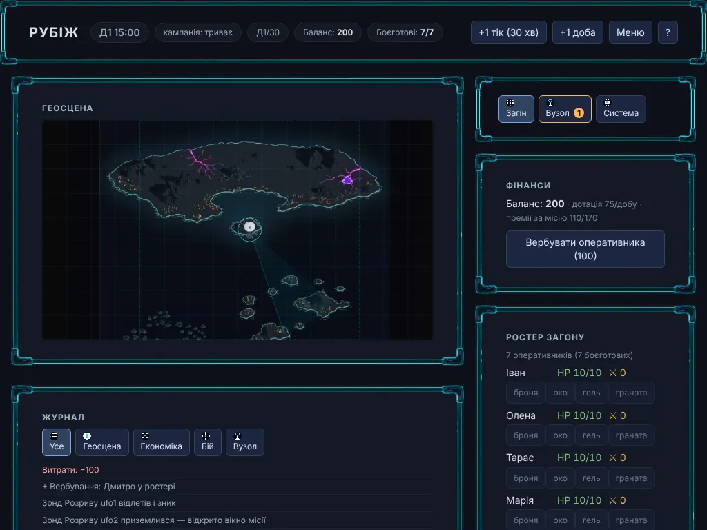
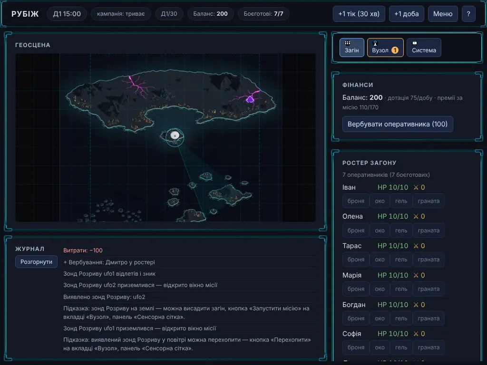
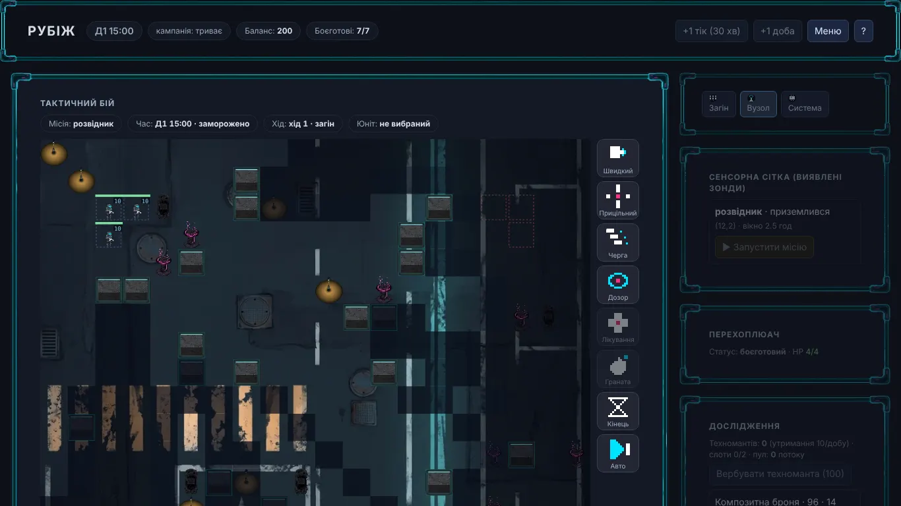
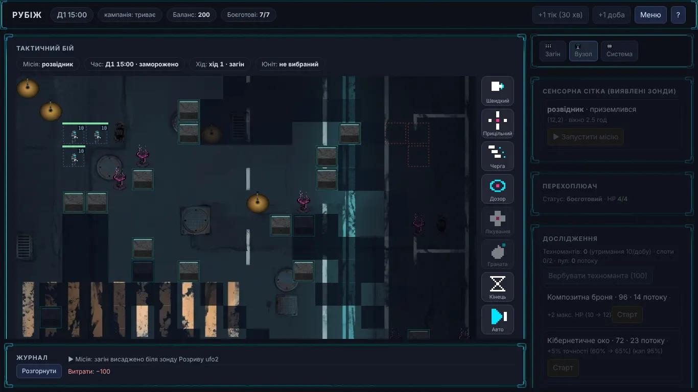
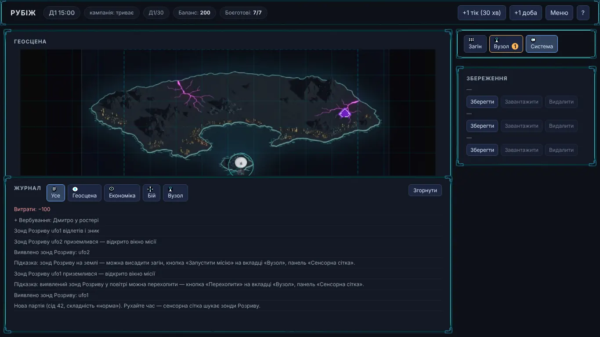

# Т.31: екран без прокрутки

Крок А огляду Т.30 (`docs/reports/t30-ux-review.md`, знахідки 3, 4, 31): карта, журнал і колонка стану — в одному екрані без прокрутки сторінки. Обрано власником 14.11.2026.

## Рішення власника (кнопками, за чотирма ескізами на 1366 × 768)

- Розкладка: варіант (г) — журнал смугою на два рядки під картою, тонша шапка і тонші рамки панелей. Відхилено: (а) смуга без зміни шапки (карта 732 × 412), (б) журнал поверх нижнього краю карти, (в) журнал четвертою вкладкою колонки.
- Повний журнал: кнопка «Розгорнути» у смузі — журнал з фільтрами відкривається поверх карти, «Згорнути» повертає смугу.

Ескізи зроблено правкою CSS на живій сторінці (`page.addStyleTag`), без зміни коду.

## Що змінено

- `index.html` — блок `@media (min-width: 900px) and (min-height: 520px)`: `html`, `body` на всю висоту вікна, сторінка не прокручується; `#layout` займає решту під шапкою, рядки сітки `minmax(0, auto) minmax(88px, 1fr)` — карта бере свою природну висоту, доки вміщається, решту отримує журнал; карта вписується в доступну висоту (`object-fit: contain`); колонка стану і фокусна зона прокручуються всередині себе, вкладки колонки липкі; шапка 94 → 58 px, рамки панелей 26 × 33 → 14 × 18 px, відступи сітки 16 → 8 px. Кнопка `#btn-log-expand` у журналі.
- `src/main.ts` — обробник кнопки: клас `expanded` на `#journal`, підпис «Розгорнути» / «Згорнути», `aria-expanded`.
- Вузькі (< 900 px) і низькі (< 520 px) вікна — без змін: прокрутка сторінки, кнопки розгортання немає.
- Ядро, сейв, правила, id наявних елементів — без змін.

## Виміри (сід 42, «норма», 30 тіків, зонд приземлився; `docs/reports/t31/measure.mjs`)

| Розмір | Висота сторінки «Загін» / «Вузол» / «Система», до | після | Карта, до | після | Верх журналу, до («Загін» / «Вузол») | після | Рядків журналу у вікні, до | після |
| --- | --- | --- | --- | --- | --- | --- | --- | --- |
| 1366 × 768 | 1 147 / 2 323 / 1 147 | 768 / 768 / 768 | 908 × 511 | 946 × 532 | 738 / 1 326 | 672 | 0 | 2 |
| 1920 × 1080 | 1 459 / 2 323 / 1 459 | 1 080 / 1 080 / 1 080 | 1 462 × 822 | 1 501 × 844 | 1 050 / 1 482 | 984 | 0 | 2 |
| iPad 1024 × 768 | 1 013 / 2 323 / 990 | 768 / 768 / 768 | 566 × 318 | 632 × 356 | 558 / 1 213 | 495 | 4 («Загін»), 0 («Вузол») | 9 |

- Розгорнутий журнал: 360 px заввишки, список 275 px (≈ 11 рядків), сторінка не росте.
- Порожнеча між картою і журналом на «Вузлі»: 604 px (1366), 448 px (1920), 683 px (iPad) → 8 px (відступ сітки).
- Колонка стану: видима висота 694 px (1366), далі прокрутка всередині колонки.
- Помилок консолі — 0 на трьох розмірах.

## Бій (поза метою кроку; підгонка поля — крок В)

- Сторінка в бою теж не прокручується; смугу журналу видно — рядки бою тепер у вікні. Поле прокручується всередині фокусної зони.
- 1366 × 768: поле 834 → 900 px (рамки тонші), у вікні видно 557 → 515 px його висоти (13,4 → 11,4 ряду клітинок). **Це гірше, ніж було, на два ряди** — ціна смуги журналу внизу; критерій «не гірше» в цій частині не виконано. 1920 × 1080: поле 960 px, видно 869 → 827 px. iPad: поле 492 → 558 px, видно 492 → 515 px (раніше поле вміщалось цілком, тепер бракує 43 px).
- Рядок підказки бою `#binfo` лишається під полем — крок В.

## Гейт

Сценарій приймання `e2e/acceptance.scenario.ts`, новий крок «геосцена: екран без прокрутки, журнал у вікні» (вікно 1440 × 900), на кожній із трьох вкладок: висота сторінки ≤ висоти вікна; нижній край `#journal` у вікні; список журналу ≥ 40 px (два рядки); карта ≥ половини висоти вікна; проміжок між панеллю карти і журналом ≤ 16 px. Потім: «Розгорнути» показує фільтри, список ≥ 200 px, сторінка і журнал у вікні; «Згорнути» ховає фільтри.

Перевірка поломками (збірка зі зламаним CSS, сценарій проти неї):

| Поломка | Результат |
| --- | --- |
| Старий `index.html` (`main`) | червоний: «вкладка squad: сторінка вища за вікно», 1 067 > 900 |
| Колонка стану без `overflow-y: auto` | червоний: «вкладка base: сторінка вища за вікно», 1 932 > 900 |
| Карта з фіксованою висотою 300 px | червоний: «карта нижча за половину вікна», 300 < 450 |
| Журнал без межі висоти (рядок сітки `auto`, список `max-height: 420px`) | зелений: сторінка лишається у вікні, журнал росте за рахунок карти — критерії кроку не порушено |

`src/main.ui.test.ts` — тест кнопки (клас, підпис, `aria-expanded`); розкладки jsdom не бачить.

## Знімки (`docs/reports/t31/shots/`)

| | До | Після |
| --- | --- | --- |
| 1366 × 768, «Вузол» |  |  |
| 1920 × 1080, «Вузол» |  |  |
| iPad, «Загін» |  |  |
| 1366 × 768, бій |  |  |

Розгорнутий журнал, 1366 × 768: 

## Межі

- Оцінено знімки і виміри, не живу гру: плавність прокрутки колонки, дотик на iPad, вигляд тонших рамок — за власником на прев'ю.
- Карта вписана через `object-fit`: якщо панель ширша за карту, з боків лишаються смуги кольору панелі (1366 × 768 — по 14 px).
- На 1920 × 1080 журнал — ті самі два рядки: вільну висоту забирає карта.
- Вікна між 520 і ≈ 600 px заввишки не перевірялись.
